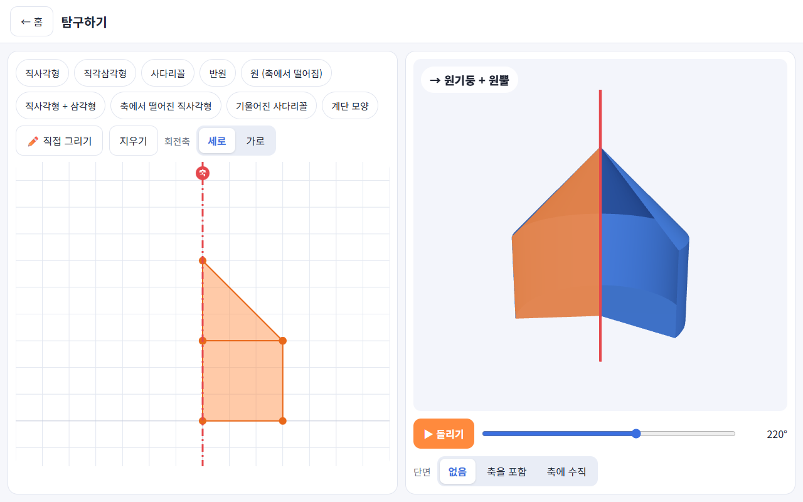
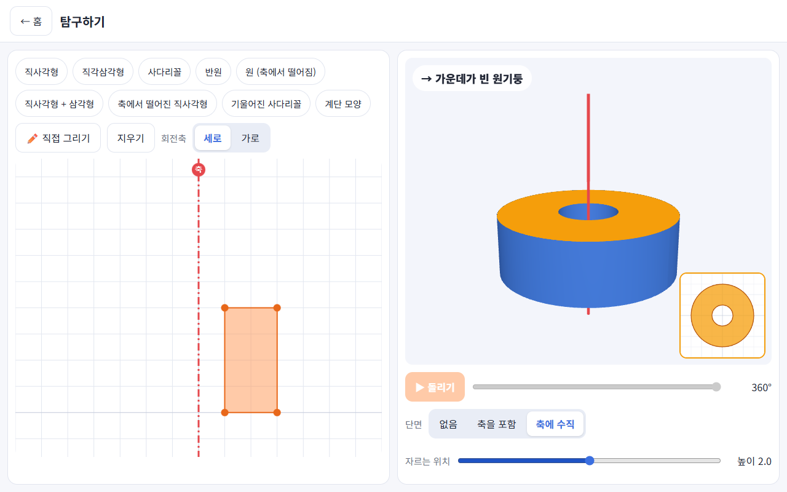
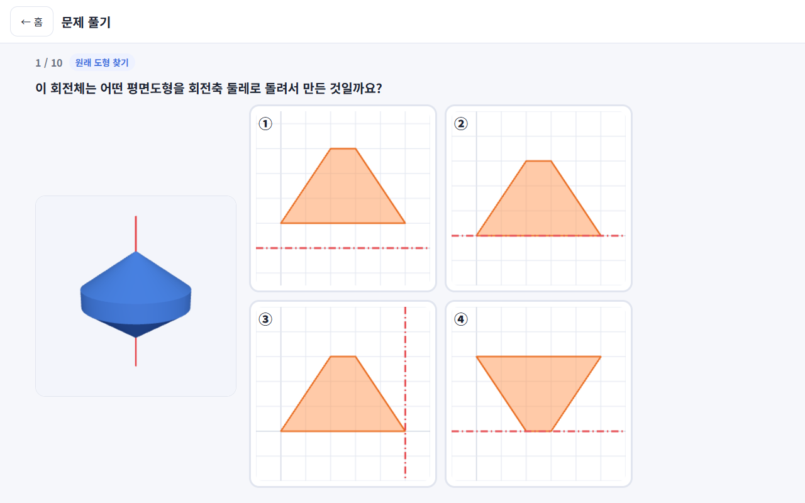

# 회전체 연습

중학교 1학년 2학기 **도형 > 회전체** 단원을 연습하는 웹앱입니다. 평면도형을 회전축 둘레로 한 바퀴 돌렸을 때 어떤 입체가 되는지 직접 돌려 보고, 자동으로 만들어지는 문제로 연습할 수 있어요.

**앱 바로 열기 → https://chris-yoo80.github.io/revolution-practice/**

로그인이나 설치 파일 없이 브라우저에서 바로 쓸 수 있고, 태블릿에 앱처럼 설치하면 인터넷 없이도 동작해요.



## 무엇을 할 수 있나요

### 탐구하기
- 직사각형, 직각삼각형, 사다리꼴, 반원, 축에서 떨어진 원, 기울어진 사다리꼴 등 준비된 도형을 고르거나 **모눈에 직접 다각형을 그려요.**
- 회전축을 세로/가로로 바꾸고, **손가락으로 끌어서 위치를 옮길 수 있어요.**
- ▶ 돌리기 또는 슬라이더로 0°부터 360°까지 도형이 돌며 회전체가 만들어지는 과정을 봐요. 3D 화면은 손가락으로 돌려 볼 수 있어요.
- 만들어진 회전체의 이름을 알려 줘요. (원기둥, 원뿔, 원뿔대, 구, "원기둥 + 원뿔" 같은 복합 회전체, 가운데가 빈 회전체)
- **단면 보기**: 회전축을 포함하는 평면, 회전축에 수직인 평면으로 잘라 단면 모양을 확인해요.



### 문제 풀기
10문제씩, 매번 새로 만들어지는 4지선다 문제예요.

| 유형 | 문제 | 보기 |
|---|---|---|
| 회전체 맞히기 | 평면도형과 회전축 | 회전체 4개 |
| 원래 도형 찾기 | 회전체 | 평면도형과 회전축 4개 |
| 단면 맞히기 | 회전체와 자르는 평면 | 단면 4개 |

- **난이도**: 기본(직사각형·직각삼각형·사다리꼴·반원) / 응용(붙인 도형, 축에서 떨어진 도형, 축이 가로지르는 도형) / 심화(기울어진 사다리꼴·평행사변형, 사다리꼴의 밑변을 축으로 돌린 경우 등)
- 오답 보기는 학생들이 자주 하는 실수로 만들어요. 다른 변을 축으로 돌린 모양, 가운데 빈 곳을 채우거나 비운 모양, 돌리지 않고 밀어낸 각기둥, 단면을 반쪽만 그린 모양 같은 것들이에요.
- 서로 같은 회전체가 되는 보기는 자동으로 걸러져서 정답은 항상 하나예요.
- 틀리면 왜 틀렸는지 알려 주고, 원래 도형이 돌아가는 애니메이션을 보여줘요.
- 끝나면 점수와 유형별 결과를 보여 주고, 최고 기록은 그 기기에 저장돼요.



## 태블릿에 설치하기 (갤럭시탭 등 안드로이드)

1. 크롬에서 https://chris-yoo80.github.io/revolution-practice/ 를 열어요.
2. 주소창 오른쪽의 설치 아이콘을 누르거나, **⋮ 메뉴 → '앱 설치'** 를 눌러요.
3. 홈 화면에 생긴 **'회전체 연습'** 아이콘으로 실행해요.

한 번 실행한 뒤에는 인터넷 없이도 쓸 수 있어요. 새 버전이 올라오면 앱을 다시 열 때 자동으로 바뀌어요.

## 개발

Node.js 24에서 개발하고 확인했어요.

```bash
npm install
npm run dev       # 개발 서버
npm test          # 단위 테스트 (Vitest)
npm run build     # 타입 검사 + 프로덕션 빌드 (dist/)
npm run preview   # 빌드 결과 미리 보기
```

- **기술**: Vite, TypeScript, Three.js, polygon-clipping, vite-plugin-pwa
- **배포**: `master` 브랜치에 push하면 GitHub Actions가 테스트, 빌드를 거쳐 GitHub Pages에 올려요.
- **구조**: 모든 계산은 '반쪽 단면'(평면도형을 축 기준으로 접어 축 한쪽에 모은 모양) 하나에서 출발해요. 3D 렌더링, 두 종류의 단면, 회전체 이름, 보기 중복 검사가 모두 여기서 계산돼요.

```
src/geometry/  반쪽 단면, 단면, 이름 판별, 같은 회전체 비교 (순수 계산, 단위 테스트)
src/quiz/      문제·오답 생성, 채점과 최고 기록
src/render/    Three.js 3D, 캔버스 2D 그림
src/editor/    모눈 작업판 (그리기, 축 끌기)
src/ui/        홈·탐구·문제 화면
```

설계와 구현 계획은 [`docs/superpowers/`](docs/superpowers/)에 있어요.
